<div dir="rtl">

# التطبيق الـ Native — الإصدار الأول (React Native + Expo)

> تطبيق عربي (RTL) للموظفين والدعم الفني، يعمل فقط داخل شبكة المستشفى.
> الكود في مجلد [`mobile-app/`](../../mobile-app) · مرجع الـ API في [API.md](API.md) · الخطة في [PLAN.md](PLAN.md).

اللقطات مأخوذة من التطبيق نفسه (نسخة الويب للتطوير) مربوطاً بالـ API الحقيقي وبيانات تجريبية.

## الدخول والشبكة

<table>
<tr>
<td align="center" width="50%">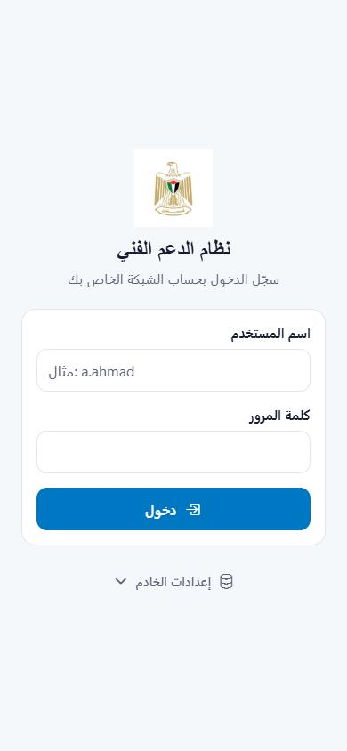<br><b>تسجيل الدخول</b><br>نفس حساب الشبكة (LDAP)، وإعدادات الخادم قابلة للتعديل</td>
<td align="center" width="50%">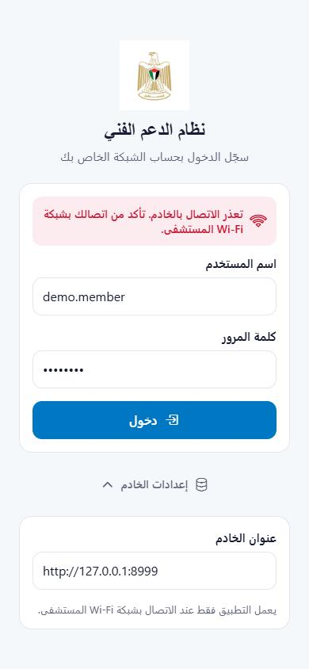<br><b>خارج شبكة المستشفى</b><br>رسالة واضحة بدل خطأ تقني</td>
</tr>
</table>

## الموظف

<table>
<tr>
<td align="center" width="33%">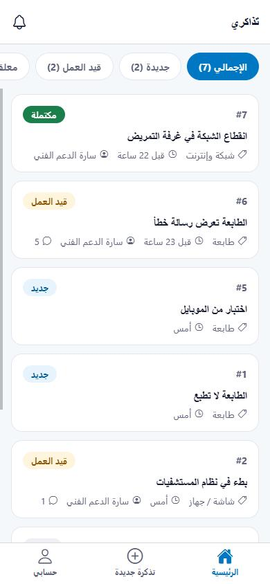<br><b>تذاكري</b><br>فلاتر الحالة مع العدد، سحب للتحديث</td>
<td align="center" width="33%">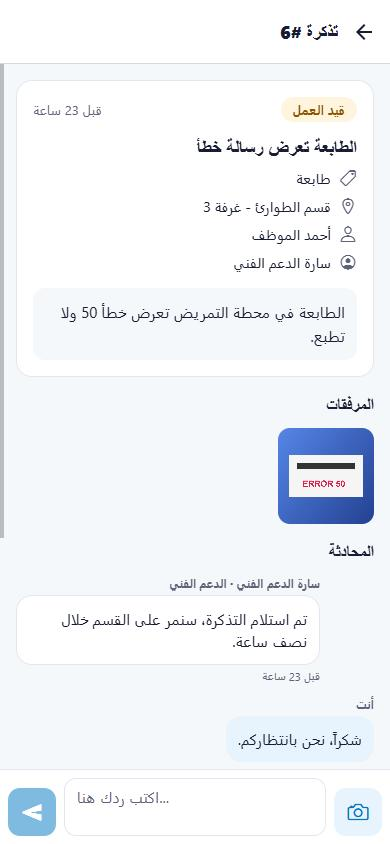<br><b>تفاصيل التذكرة</b><br>المكان والنوع والمسؤول والمرفقات</td>
<td align="center" width="33%">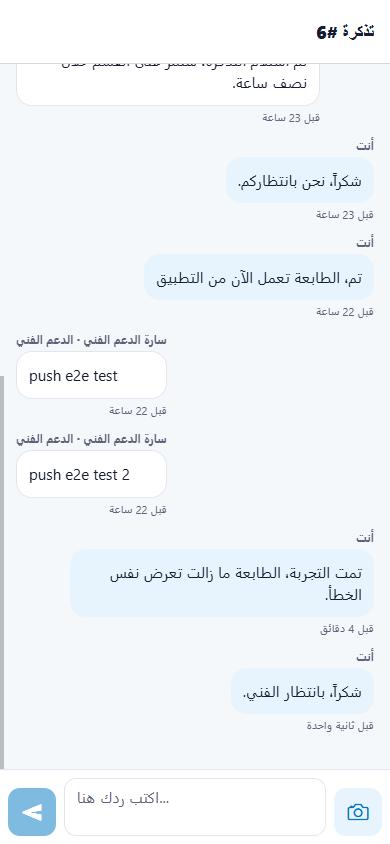<br><b>المحادثة</b><br>رد مباشر + إرفاق صورة بالكاميرا</td>
</tr>
<tr>
<td align="center">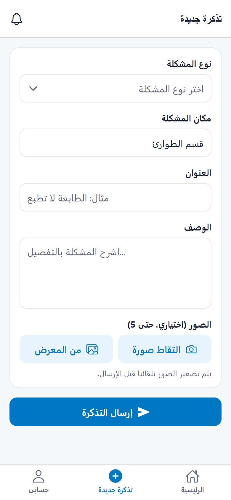<br><b>تذكرة جديدة</b><br>المكان يُعبّأ تلقائياً من الحساب</td>
<td align="center">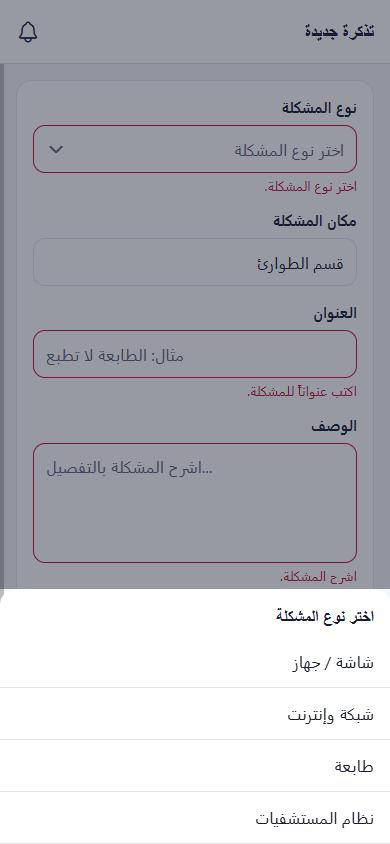<br><b>نوع المشكلة</b><br>قائمة سفلية سهلة اللمس</td>
<td align="center">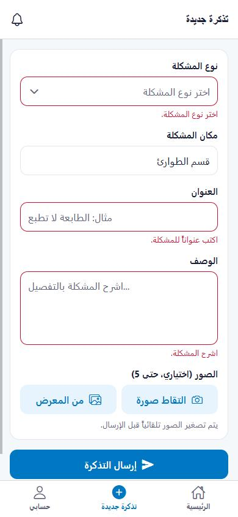<br><b>التحقق</b><br>أخطاء تحت كل حقل تختفي عند التعديل</td>
</tr>
<tr>
<td align="center">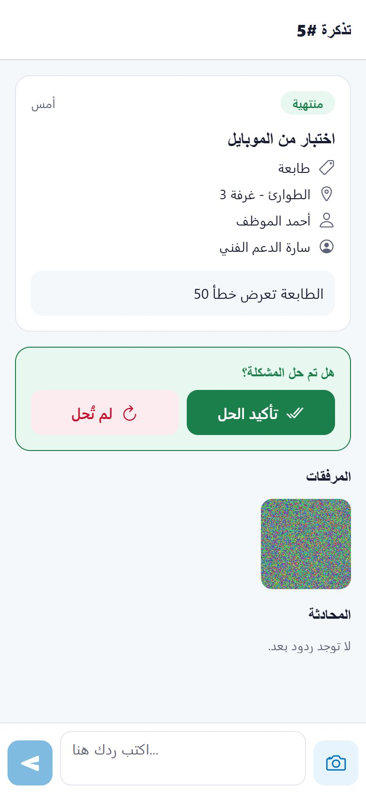<br><b>هل تم حل المشكلة؟</b><br>تأكيد الحل أو "المشكلة مستمرة"</td>
<td align="center">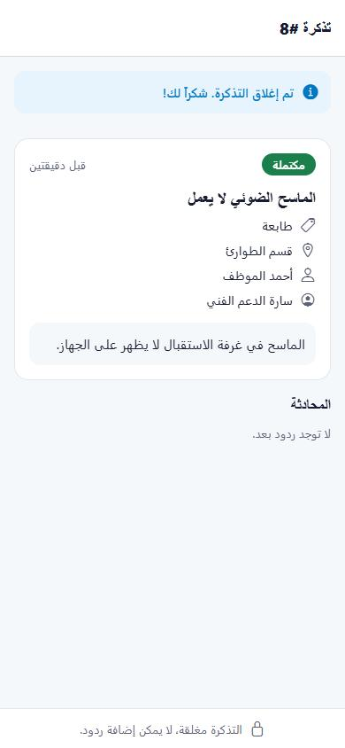<br><b>تذكرة مكتملة</b><br>الرد مقفل بعد الإغلاق</td>
<td align="center">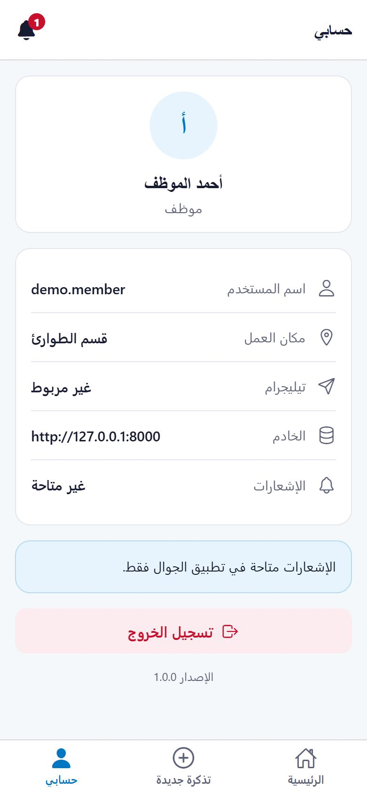<br><b>حسابي</b><br>البيانات والخادم وتسجيل الخروج</td>
</tr>
</table>

## الدعم الفني (Admin)

<table>
<tr>
<td align="center" width="50%">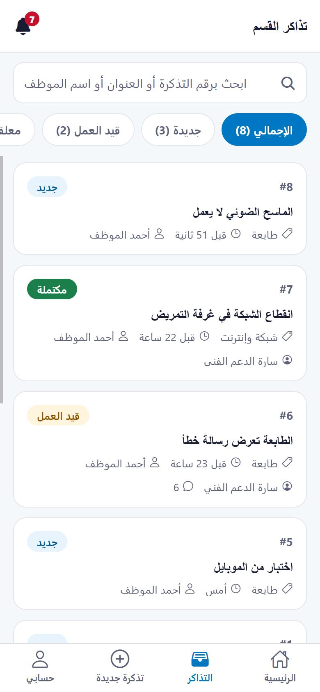<br><b>تذاكر القسم</b><br>بحث برقم التذكرة أو العنوان أو اسم الموظف + فلاتر</td>
<td align="center" width="50%">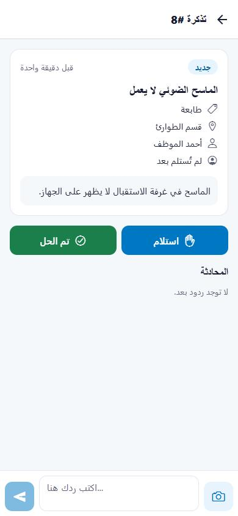<br><b>إجراءات الأدمن</b><br>استلام · تم الحل · رد</td>
</tr>
</table>

## الإشعارات

<table>
<tr>
<td align="center" width="33%">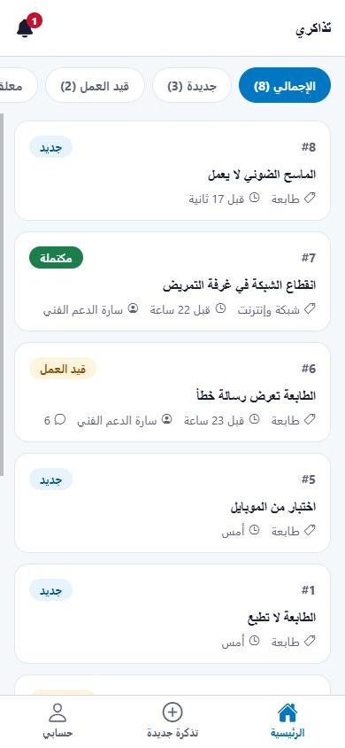<br><b>الجرس</b><br>عدد الإشعارات غير المقروءة في أعلى كل شاشة</td>
<td align="center" width="33%">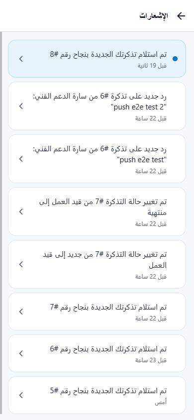<br><b>شاشة الإشعارات</b><br>غير المقروء مميز، والضغط يفتح التذكرة</td>
<td align="center" width="33%"><br><b>حالة الإشعارات</b><br>مفعّلة / غير مسموح بها / غير متاحة مع السبب وزر إعادة المحاولة</td>
</tr>
</table>

**كيف تعمل:**
1. بعد تسجيل الدخول (أو عند فتح التطبيق بجلسة محفوظة) يطلب التطبيق إذن الإشعارات، ينشئ قناة أندرويد `tickets`، يأخذ **Expo push token** ويرسله إلى `POST /api/v1/devices`.
2. أي إشعار في النظام (تذكرة جديدة، رد، تغيير حالة، تعيين...) يصل للجوال عبر خدمة Expo Push (FCM لأندرويد، APNs للآيفون) ويحمل `ticket_id`.
3. **الضغط على الإشعار يفتح التذكرة مباشرة** — حتى لو كان التطبيق مغلقاً (cold start)، وإذا لم يكن المستخدم مسجلاً بعد فتُفتح التذكرة بعد الدخول.
4. أثناء فتح التطبيق يظهر الإشعار كبانر ويتحدث عدد الجرس فوراً، ويتحدث أيضاً عند العودة للتطبيق.
5. فتح شاشة الإشعارات يعلّمها كمقروءة.
6. **تسجيل الخروج** يحذف الجهاز من الخادم فلا تصل إشعارات لجهاز مستخدم آخر.

**الإعداد (تم):**
- التطبيق مربوط بمشروع EAS `nmc-tickets` (حساب `yousefwatfa`)، و`projectId` في `app.json`.
- **Firebase (أندرويد):** مشروع `ticketsystem-15fed`، وملف `mobile-app/google-services.json` محفوظ في المستودع (معرّفات عامة فقط).
- **مفتاح FCM V1** (service account) مرفوع على EAS ← Credentials. الملف نفسه `fcm-service-account.json` **غير محفوظ في git** (ممنوع في `.gitignore` و`.easignore`) — احتفظ بنسخة آمنة منه.
- **Expo Go على أندرويد لا يدعم الإشعارات البعيدة** منذ SDK 53، لذلك نستخدم نسخة APK مبنية.
- الآيفون يحتاج حساب Apple Developer لمفاتيح APNs (يديرها EAS تلقائياً).
- تم التحقق أن سيرفر 172.16.10.105 يصل لخدمة Expo عبر HTTPS ويستقبل رد `DeviceNotRegistered` للرموز غير الصالحة (فتُحذف تلقائياً).

## بناء نسخة أندرويد (APK)

```bash
cd mobile-app
npx eas-cli@latest build -p android --profile preview
```

- البناء على سحابة EAS (~10 دقائق)، والنتيجة رابط APK + QR في صفحة البناء على expo.dev.
- `.easignore` في جذر المستودع يرفع مجلد `mobile-app` فقط — كود الخادم لا يغادر المستشفى.
- التثبيت: السماح بـ "التثبيت من مصادر غير معروفة"، وتجاهل تحذير Play Protect (التطبيق ليس من Google Play).
- الطرفية في ويندوز: استخدم `npx.cmd` بدل `npx` إذا منع PowerShell تشغيل السكربتات.

## ما تم اختباره فعلياً

آخر جولة اختبار للشاشات (28-10-2026) — اللقطات أعلاه منها — دورة كاملة عبر التطبيق مقابل الـ API:
1. خادم غير متاح ← رسالة "تأكد من اتصالك بشبكة Wi-Fi المستشفى".
2. الموظف يسجّل الدخول ويرى تذاكره مع عدد كل حالة.
3. يفتح تذكرة ← التفاصيل والمرفقات والمحادثة ← يرد ← **يظهر الرد وتنزل المحادثة إليه**.
4. تذكرة جديدة: إرسال فارغ ← أخطاء تحت كل حقل ← اختيار النوع يزيل خطأه ← تُنشأ التذكرة وتُفتح مباشرة.
5. إشعار "تم استلام تذكرتك" يظهر في الجرس ← الضغط عليه يفتح التذكرة.
6. تسجيل الخروج ← الأدمن يدخل ← "تذاكر القسم" ← البحث بالعنوان ← **استلام** ← **تم الحل**.
7. الموظف يرى "هل تم حل المشكلة؟" ← **تأكيد الحل** ← التذكرة مكتملة والرد مقفل.

إصلاحات من هذه الجولة: المحادثة لم تكن تنزل للرد الجديد بعد إرساله، وزر "المشكلة مستمرة" كان يلتف على سطرين (أصبح "لم تُحل").

الفحوصات: `npx tsc --noEmit` و`npx eslint src` نظيفة، و46 اختبار للخادم (`php artisan test`).

## لم يُنفّذ بعد

- **تجربة الإشعارات على جوال حقيقي** بالـ APK الجديد (Firebase جاهز).
- **الآيفون** — يحتاج حساب Apple Developer، و**HTTPS** على الخادم (iOS يمنع HTTP العادي).

</div>
