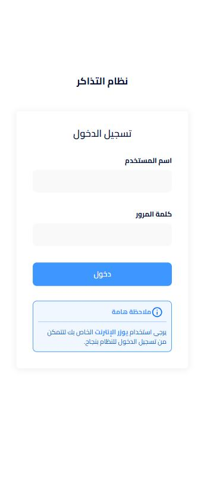
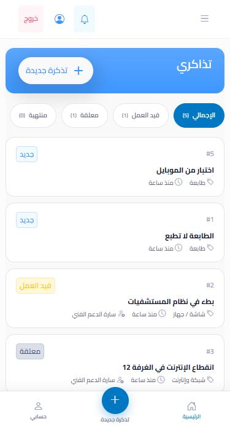
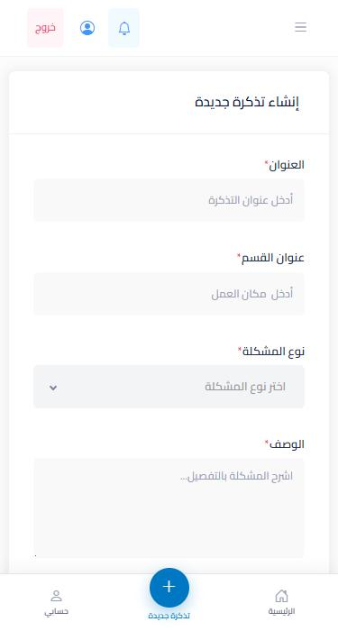
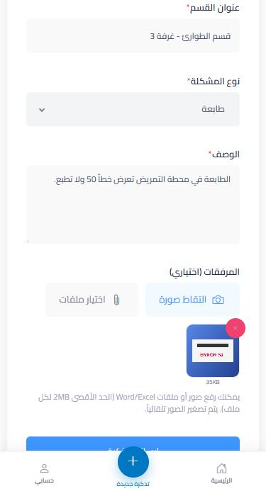
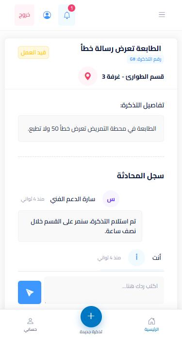
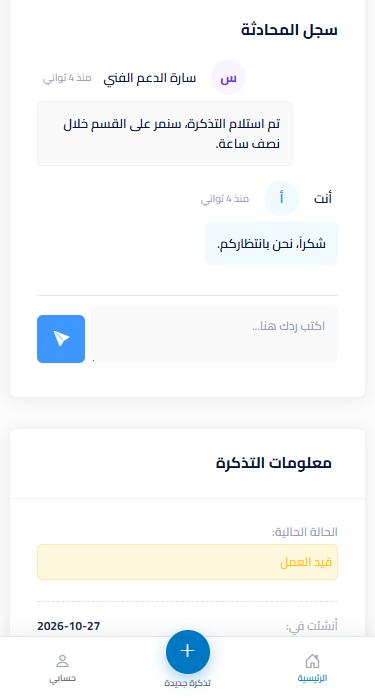
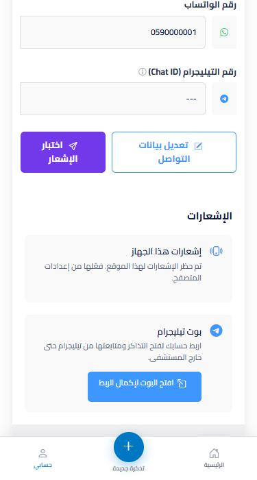
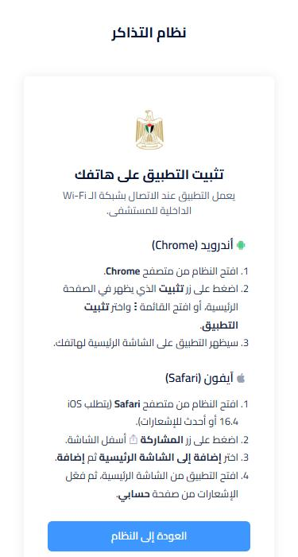
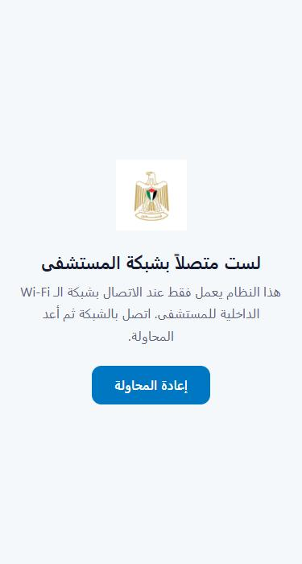
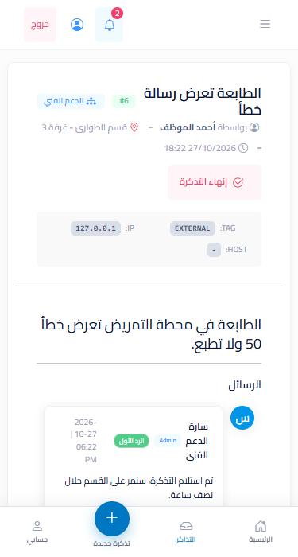

<div dir="rtl">

# توثيق تطبيق الويب التقدمي (PWA) — نظام الدعم الفني والمهام

> **المرحلة الأولى من الوصول عبر الموبايل.**
> النظام نفسه (Laravel) صار يعمل كتطبيق قابل للتثبيت على أندرويد وآيفون من داخل شبكة المستشفى، مع إشعارات فورية وبوت تيليجرام.

| | |
|---|---|
| **المستودع** | `yousefwatfa/ticketsystem-mobile` |
| **النسخة التجريبية** | `http://172.16.10.105:9091` (داخل شبكة المستشفى فقط) |
| **التقنيات** | Laravel 12 · Blade · Bootstrap/Metronic RTL · Service Worker · Web Push (VAPID) · Telegram Bot API |
| **الاختبارات** | 29 اختبار آلي ناجح (`php artisan test`) |

---

## المحتويات

1. [نظرة عامة](#1-نظرة-عامة)
2. [لقطات الشاشة](#2-لقطات-الشاشة)
3. [الميزات بالتفصيل](#3-الميزات-بالتفصيل)
4. [كيف يعمل (البنية التقنية)](#4-كيف-يعمل-البنية-التقنية)
5. [بوت تيليجرام](#5-بوت-تيليجرام)
6. [الأمان والخصوصية](#6-الأمان-والخصوصية)
7. [الملفات التي تم تعديلها أو إضافتها](#7-الملفات-التي-تم-تعديلها-أو-إضافتها)
8. [دليل التثبيت للموظفين](#8-دليل-التثبيت-للموظفين)
9. [النشر والاختبار](#9-النشر-والاختبار)
10. [القيود المعروفة والخطوات القادمة](#10-القيود-المعروفة-والخطوات-القادمة)

---

## 1. نظرة عامة

### المشكلة
- النظام كان مصمماً للكمبيوتر: جداول DataTables وقوائم علوية يصعب استخدامها على الجوال.
- صور الجوال (3–5 ميجابايت) كانت تُرفض لأن الحد الأقصى للمرفق **2 ميجابايت**.
- السيرفر داخلي (لا يصل إليه الإنترنت)، فلا يمكن استخدام تطبيقات المتاجر أو webhooks بسهولة.

### الحل
| المكوّن | الوظيفة | أين يعمل |
|---|---|---|
| **PWA** | النظام كتطبيق مثبّت على الشاشة الرئيسية بواجهة مخصصة للجوال | على Wi-Fi المستشفى فقط |
| **Web Push** | إشعار فوري على الجوال عند كل رد أو تغيير حالة | يصل الإشعار في أي مكان، وفتح التذكرة يحتاج الشبكة |
| **بوت تيليجرام** | فتح ومتابعة التذاكر والرد عليها وتأكيد الحل | في أي مكان (السيرفر يتصل بتيليجرام ولا يحتاج اتصالاً وارداً) |

---

## 2. لقطات الشاشة

> اللقطات مأخوذة بحجم شاشة جوال (375px) من بيانات تجريبية.

### الموظف (Member)

<table>
<tr>
<td align="center" width="33%"><br><b>تسجيل الدخول</b><br>نفس حساب الشبكة (LDAP)</td>
<td align="center" width="33%"><br><b>تذاكري</b><br>بطاقات + فلاتر الحالة + شريط تنقل سفلي</td>
<td align="center" width="33%"><br><b>تذكرة جديدة</b><br>حقول كبيرة مناسبة للمس</td>
</tr>
<tr>
<td align="center"><br><b>التقاط صورة</b><br>معاينة + الحجم بعد الضغط</td>
<td align="center"><br><b>تفاصيل التذكرة</b><br>الحالة والمكان والمحادثة</td>
<td align="center"><br><b>المحادثة</b><br>خانة الرد ثابتة فوق شريط التنقل</td>
</tr>
<tr>
<td align="center"><br><b>حسابي ← الإشعارات</b><br>تفعيل إشعارات الجهاز وربط تيليجرام</td>
<td align="center"><br><b>دليل التثبيت</b> (<code>/install</code>)<br>خطوات أندرويد وآيفون</td>
<td align="center"><br><b>خارج الشبكة</b><br>صفحة تظهر عند عدم الوصول للسيرفر</td>
</tr>
</table>

### الدعم الفني (Admin)

<table>
<tr>
<td align="center" width="33%"><br><b>عرض التذكرة للأدمن</b><br>شريط التنقل يضيف تبويب "التذاكر"</td>
<td width="67%">

**ما يختلف للأدمن على الجوال:**
- تبويب **التذاكر** في شريط التنقل السفلي.
- الإشعارات تصل كـ Push وفي تيليجرام مع أزرار **استلام / تم الحل**.
- شاشات الإدارة (التقارير، المستخدمين، الهيكلية) بقيت بتصميم الكمبيوتر — راجع [القيود](#10-القيود-المعروفة-والخطوات-القادمة).

</td>
</tr>
</table>

---

## 3. الميزات بالتفصيل

### 3.1 التثبيت كتطبيق
- ملف `manifest.json`: اسم عربي، اتجاه `rtl`، وضع `standalone` (بدون شريط المتصفح)، أيقونات 192/512 وأيقونة maskable لأندرويد، واختصارات "تذكرة جديدة" و"تذاكري" عند الضغط المطوّل على الأيقونة.
- **أندرويد (Chrome):** يظهر شريط "ثبّت التطبيق على هاتفك" في الصفحة الرئيسية ويمكن إخفاؤه.
- **آيفون (Safari):** لا يوجد زر تثبيت تلقائي، فالشريط يوجّه المستخدم إلى صفحة `/install` (مشاركة ← إضافة إلى الشاشة الرئيسية).

### 3.2 واجهة مخصصة للجوال
مبنية وفق قواعد **UI UX Pro Max**:

| القاعدة | التطبيق |
|---|---|
| أهداف لمس ≥ 44–48px | الأزرار وحقول الإدخال وعناصر شريط التنقل |
| شريط تنقل سفلي ≤ 5 عناصر مع نص | الرئيسية · التذاكر (للأدمن) · تذكرة جديدة · حسابي |
| احترام المناطق الآمنة (notch / شريط الإيماءات) | `env(safe-area-inset-*)` و`viewport-fit=cover` |
| المحتوى لا يختفي خلف الأشرطة الثابتة | مسافة سفلية للصفحة بارتفاع الشريط |
| تباين النص ≥ 4.5:1 | الأزرار المعبأة تستخدم `#0077c2` بدل `#009ef7` (2.9:1) |
| دعم تقليل الحركة | `prefers-reduced-motion` يوقف الحركات |
| أيقونات متجهة بدل الإيموجي | Bootstrap Icons مع `aria-hidden` للأيقونات الزخرفية |

- **تذاكري:** على الجوال تظهر بطاقات بدل الجدول، مع شرائح فلترة (الإجمالي، قيد العمل، معلقة، منتهية، مكتملة) تعمل فوراً بدون إعادة تحميل. على الكمبيوتر بقي الجدول والبطاقات الإحصائية كما هي.
- **تفاصيل التذكرة:** خانة الرد تبقى ظاهرة أسفل الشاشة مع زر إرسال كبير.
- **رأس الصفحة:** الساعة تختفي على الشاشات الصغيرة لتوفير المساحة، والتذييل يظهر على الكمبيوتر فقط.

### 3.3 التقاط الصور وضغطها تلقائياً
- زران: **التقاط صورة** (يفتح الكاميرا الخلفية مباشرة) و**اختيار ملفات**.
- كل صورة تُصغَّر داخل المتصفح إلى أطول ضلع **1600px** وتُحفظ JPEG بجودة 82% (تنخفض إلى 70% ثم 55% إذا لزم) حتى تكون أقل من 2MB.
- **نتيجة الاختبار:** صورة 3.0MB ← **0.87MB** بمقاس 1600×1200.
- معاينة لكل ملف مع حجمه بعد الضغط وزر حذف.
- رسائل خطأ واضحة لنوع ملف غير مسموح أو ملف أكبر من 2MB.
- زر الإرسال يتعطل ويعرض "جاري الإرسال..." لمنع الإرسال المكرر.
- على الجوال لا يحاول النظام قراءة بيانات الجهاز من البرنامج المحلي (`127.0.0.1:10000`) المخصص لأجهزة الكمبيوتر، فلا يوجد انتظار 3 ثوانٍ ولا رسالة تحذير.

### 3.4 الإشعارات على الجهاز (Web Push)
- يفعّلها المستخدم من **حسابي ← الإشعارات ← فعّل الإشعارات**.
- كل إشعار موجود في النظام (تذكرة جديدة، رد، تغيير حالة، تعيين...) يصل أيضاً للأجهزة المفعّلة، لأن القناة أضيفت إلى `RealTimeNotification` المستخدم في كل مكان.
- الضغط على الإشعار يفتح التذكرة مباشرة (رابط الأدمن أو الموظف حسب الدور).
- الإشعارات لنفس التذكرة تُجمع (`tag`) بدل تكديسها.
- **الترتيب مهم:** Push يُرسل **قبل** تيليجرام، لأن فشل قناة تيليجرام (رقم محادثة خاطئ) كان سيوقف القنوات التي بعدها.
- رسائل حالة واضحة: غير مدعوم، محظور من إعدادات المتصفح، يحتاج تثبيت على الآيفون، مفعّل/غير مفعّل.

### 3.5 العمل خارج الشبكة
- عند فتح التطبيق خارج شبكة المستشفى تظهر صفحة **"لست متصلاً بشبكة المستشفى"** مع زر إعادة المحاولة بدل صفحة خطأ المتصفح.

---

## 4. كيف يعمل (البنية التقنية)

### 4.1 الصورة العامة

```
┌──────────────── جوال الموظف ────────────────┐
│  التطبيق المثبّت (PWA)                       │
│   ├─ Service Worker (sw.js)                  │
│   │    • يخزن الملفات الثابتة فقط (CSS/JS/أيقونات) │
│   │    • الصفحات والبيانات من الشبكة دائماً       │
│   │    • يعرض offline.html عند انقطاع الشبكة     │
│   └─ يستقبل Push ويعرض الإشعار                   │
└──────────────┬──────────────────▲────────────┘
     Wi-Fi المستشفى              │ Push
               ▼                  │
┌──────────── سيرفر Laravel (داخلي) ─────────────┐
│  TicketService ── RealTimeNotification ──┬─► قاعدة البيانات (الجرس)  │
│        ▲                                 ├─► Reverb (فوري على الويب)  │
│        │                                 ├─► WebPush ──► FCM / Apple ─┘
│        │                                 └─► Telegram ──► api.telegram.org
│  telegram:poll ◄── getUpdates (اتصال صادر فقط) ── Telegram           │
└──────────────────────────────────────────────────────────────────┘
```

### 4.2 Service Worker (`public/sw.js`)
| نوع الطلب | السياسة |
|---|---|
| تنقل الصفحات (HTML) | من الشبكة دائماً؛ عند الفشل `offline.html` |
| `/assets` `/build` `/icons` `/fonts` | من الذاكرة أولاً ثم الشبكة (وتُحفظ نسخة) |
| AJAX، رفع الملفات، DataTables، أي شيء آخر | من الشبكة مباشرة بدون تخزين |
| `push` | عرض إشعار عربي `rtl` |
| `notificationclick` | فتح التذكرة أو التركيز على نافذة مفتوحة |

لتحديث الملفات المخزنة بعد تغيير كبير: غيّر `VERSION` في أعلى `sw.js`.

### 4.3 تدفق الإشعار
1. المتصفح ينشئ اشتراكاً باستخدام مفتاح VAPID العام (من `<meta name="vapid-public-key">`).
2. `POST /push-subscriptions` يحفظه في جدول `push_subscriptions` مربوطاً بالمستخدم.
3. عند أي حدث: `RealTimeNotification::via()` يضيف `WebPushChannel` إذا كان للمستخدم اشتراك.
4. `toWebPush()` يبني الرسالة (العنوان، النص، الأيقونة، `tag`، رابط التذكرة) وترسلها المكتبة إلى خدمة الإشعارات.
5. الاشتراكات المنتهية تُحذف تلقائياً.

### 4.4 `TicketService` — منطق مشترك
كل عمليات التذاكر نُقلت إلى خدمة واحدة يستخدمها الموقع والبوت معاً، فالقواعد والسجلات والإشعارات واحدة:

| الدالة | الاستخدام |
|---|---|
| `create()` | إنشاء تذكرة + مرفقات + سجل + إشعار الأدمن والقسم وصاحب التذكرة؛ ترفض إذا كانت هناك تذكرة منتهية بانتظار التأكيد |
| `addMessage()` | رد + إشعارات؛ أول رد من أدمن ينقل التذكرة إلى "قيد العمل" ويعيّنها له |
| `confirmClose()` | صاحب التذكرة يؤكد الحل ← مكتملة |
| `reportNotFixed()` | صاحب التذكرة يبلّغ أن المشكلة مستمرة ← قيد العمل |
| `take()` | الأدمن يستلم التذكرة |
| `markFinished()` | الأدمن ينهي التذكرة بانتظار تأكيد صاحبها |

---

## 5. بوت تيليجرام

يعمل بأمر `php artisan telegram:poll` كخدمة دائمة. يستخدم **long polling**: السيرفر هو من يتصل بتيليجرام، فلا حاجة لفتح أي منفذ وارد.

| للموظف | للأدمن |
|---|---|
| `/new` فتح تذكرة خطوة بخطوة: نوع المشكلة ← المكان (أو "مكان عملي") ← العنوان ← الوصف ← حتى 3 صور ← مراجعة وإرسال | زر **استلام** (تعيين + قيد العمل) |
| `/my` آخر 10 تذاكر مفتوحة مع أزرار | زر **تم الحل** |
| الرد على أي إشعار فيه `#رقم` يضيف رداً على التذكرة (نصاً أو صورة) | زر **رد على التذكرة** |
| أزرار **تأكيد الحل / المشكلة مستمرة** عند انتهاء التذكرة | يرى تذاكره والتذاكر المكلّف بها في `/my` |

**ربط الحساب:** حسابي ← ربط الحساب ← افتح البوت لإكمال الربط ← Start. الرمز يُستخدم مرة واحدة فقط.

**الحماية:** يعمل فقط في المحادثات الخاصة مع حساب مربوط؛ كل إجراء يمر بصلاحيات `TicketPolicy`؛ مجموعات الأقسام تستقبل الإشعارات فقط؛ حد 30 طلب بالدقيقة لكل محادثة؛ الضغط المكرر على "إرسال" لا ينشئ تذكرة مكررة؛ رسالة تنبيه بعدم إرسال بيانات المرضى.

---

## 6. الأمان والخصوصية

| البند | الوضع |
|---|---|
| بيانات التذاكر على الجوال | **لا تُخزَّن** — الـ Service Worker يخزن الملفات الثابتة فقط |
| route `/debug/hospitals` (كان يعرض أسماء الموظفين بدون دخول) | **حُذف** |
| ملفات `debug*.php` و`tools/` (فيها token البوت وأرقام محادثات) | **حُذفت**؛ المستودع الجديد بتاريخ git جديد |
| المستودع القديم `ticketsystem` | أصبح **خاصاً** |
| token البوت القديم | ⚠️ **يجب إلغاؤه من @BotFather** |
| النسخة التجريبية | قاعدة بيانات منفصلة، بدون Realtime، بدون تيليجرام، وcookie جلسة منفصلة |
| HTTPS | ⚠️ **مطلوب** — حالياً كلمة سر الشبكة تُرسل بدون تشفير على HTTP |

---

## 7. الملفات التي تم تعديلها أو إضافتها

<details>
<summary><b>عرض القائمة الكاملة</b></summary>

**PWA**
- `public/manifest.json` · `public/sw.js` · `public/offline.html` · `public/icons/*`
- `resources/views/layouts/_pwa_head.blade.php` · `_bottom_nav.blade.php`
- `resources/views/partials/_install_banner.blade.php` · `resources/views/pwa/install.blade.php`
- `resources/css/mobile.css`

**الشاشات**
- `resources/views/layouts/app.blade.php` · `auth.blade.php` · `_menu_links.blade.php`
- `resources/views/dashboard.blade.php` · `tickets/create.blade.php` · `tickets/show.blade.php` · `profile/index.blade.php`

**JavaScript**
- `resources/js/attachments.js` (ضغط الصور) · `resources/js/push.js` · `resources/js/echo.js` (لم يعد يعطل الصفحة عند غياب Reverb)

**الخادم**
- `app/Services/TicketService.php`
- `app/Services/Telegram/TelegramApi.php` · `TelegramBotService.php` · `app/Console/Commands/TelegramPoll.php`
- `app/Http/Controllers/PushSubscriptionController.php` · `TicketController` · `MessageController` · `AdminTicketController` · `TelegramController`
- `app/Notifications/RealTimeNotification.php` · `app/Models/User.php`
- `config/webpush.php` · `config/services.php` · `routes/web.php`

**قاعدة البيانات**
- `2026_10_27_000001_create_push_subscriptions_table`
- `2026_10_27_000002_add_telegram_link_columns_to_users_table` (الأعمدة كانت مستخدمة بدون migration)

**الاختبارات**
- `tests/Feature/TicketServiceTest.php` · `TelegramBotTest.php` · `TicketWebFlowTest.php` · `PwaAndPushTest.php` · `NotificationChannelsTest.php`
- `database/seeders/DemoSeeder.php` (بيانات تجريبية محلية فقط)

</details>

---

## 8. دليل التثبيت للموظفين

> يُرسل هذا القسم للموظفين كما هو.

**أندرويد**
1. اتصل بشبكة Wi-Fi المستشفى.
2. افتح رابط النظام في **Chrome** وسجّل الدخول بحساب الشبكة.
3. اضغط **تثبيت** في الشريط الأزرق، أو القائمة ⋮ ← **تثبيت التطبيق**.
4. افتح **حسابي ← فعّل الإشعارات** واسمح بها.

**آيفون (iOS 16.4 أو أحدث)**
1. اتصل بشبكة Wi-Fi المستشفى.
2. افتح رابط النظام في **Safari** وسجّل الدخول.
3. اضغط زر **المشاركة** ← **إضافة إلى الشاشة الرئيسية** ← **إضافة**.
4. افتح التطبيق **من الشاشة الرئيسية**، ثم **حسابي ← فعّل الإشعارات**.

**تيليجرام (اختياري)**
- حسابي ← **ربط الحساب** ← **افتح البوت لإكمال الربط** ← **Start**.

---

## 9. النشر والاختبار

- دليل النشر الكامل وقائمة الفحص: [`Documantation/mobile-deployment.md`](../../Documantation/mobile-deployment.md)
- وثيقة التصميم: [`Documantation/phase1-mobile-design.md`](../../Documantation/phase1-mobile-design.md)

### الوضع الحالي على السيرفر `172.16.10.105` (Ubuntu 24.04 · Apache · PHP 8.4)

| النسخة | المسار | المنفذ | قاعدة البيانات |
|---|---|---|---|
| الإنتاج | `/var/www/html/ticket-system` | 80 | (لم تتغير) |
| Stage | `/var/www/html/ticket-system-stage` | 9090 | `ticket_system_stage` (لم تتغير) |
| **Mobile (تجريبية)** | `/var/www/html/ticketsystem-mobile` | **9091** | `ticket_system_mobile` (نسخة من stage) |

**تحديث النسخة التجريبية:**
```bash
cd /var/www/html/ticketsystem-mobile
git pull --ff-only
composer install --no-dev --optimize-autoloader
npm ci && npm run build
php artisan migrate --force
php artisan optimize:clear
```

### الاختبارات الآلية
```bash
php artisan test
```
29 اختبار تغطي: `TicketService`، مسارات الويب، اشتراكات Push، الـ manifest وصفحة التثبيت، تسلسلات البوت كاملة (مع محاكاة Telegram API)، وترتيب قنوات الإشعار.

---

## 10. القيود المعروفة والخطوات القادمة

### القيود
- **HTTPS غير مفعّل بعد:** بدونه لا يمكن تثبيت التطبيق ولا تفعيل الإشعارات على الجوال (المتصفحات تشترطه). الشاشات تعمل من متصفح الجوال.
- **الآيفون:** الإشعارات تعمل فقط من التطبيق المثبّت (iOS 16.4+).
- **شاشات الأدمن** (قائمة التذاكر، التقارير، المستخدمين، الأقسام) ما زالت بتصميم الكمبيوتر على الجوال.
- **الإشعارات تُرسل داخل الطلب** (كما كان النظام سابقاً)؛ مع عدد كبير من الأدمن يُفضّل جعل `RealTimeNotification` يعمل عبر الطابور (`ShouldQueue`).
- `composer audit` يظهر تحذيرات أمنية في مكتبات قديمة في المشروع — تحتاج مراجعة منفصلة.

### الخطوات القادمة
1. إلغاء token البوت القديم وإنشاء **بوت تجريبي**.
2. سجل DNS داخلي (مثل `tickets-test.nmc.gov.ps`) + شهادة Let's Encrypt عبر DNS-01.
3. اختبار التثبيت والإشعارات على أجهزة حقيقية.
4. **المرحلة الثانية:** تطبيق Native (Flutter أو React Native) + API.

</div>
